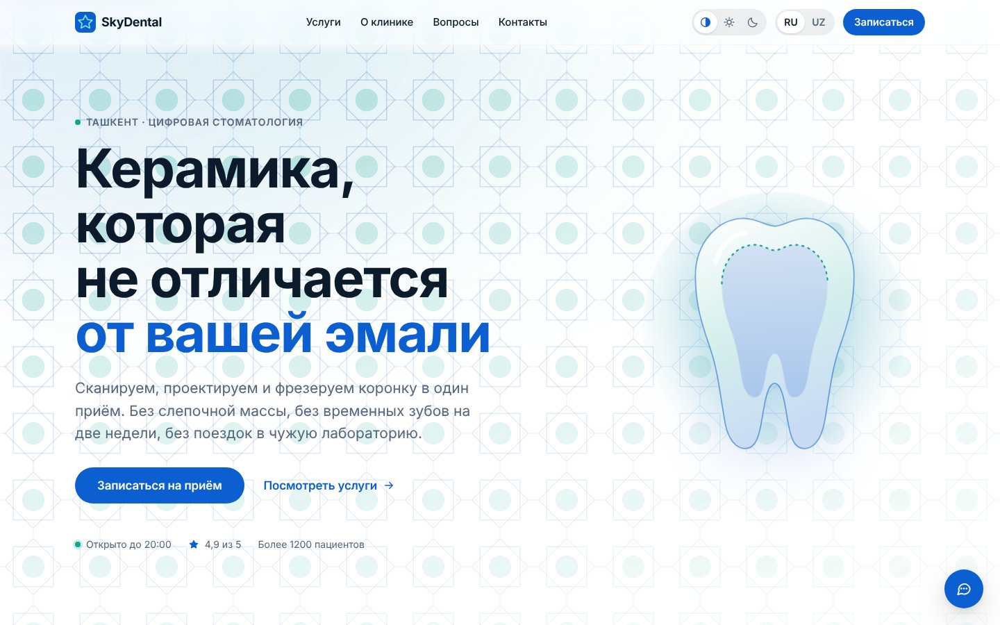
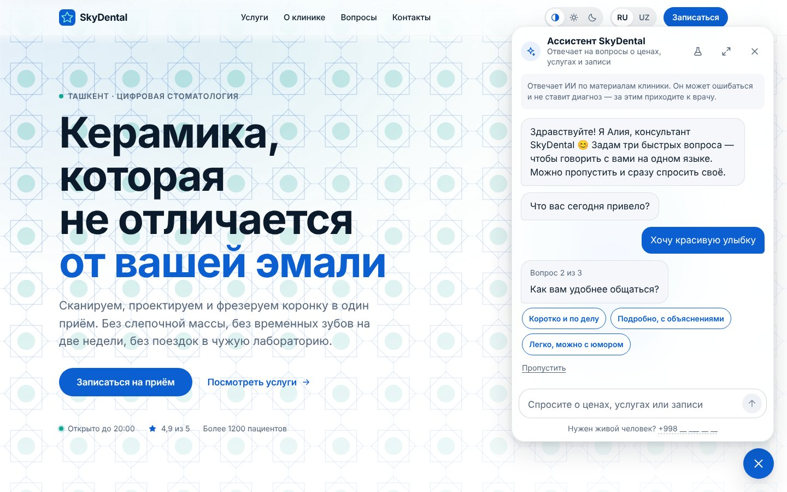
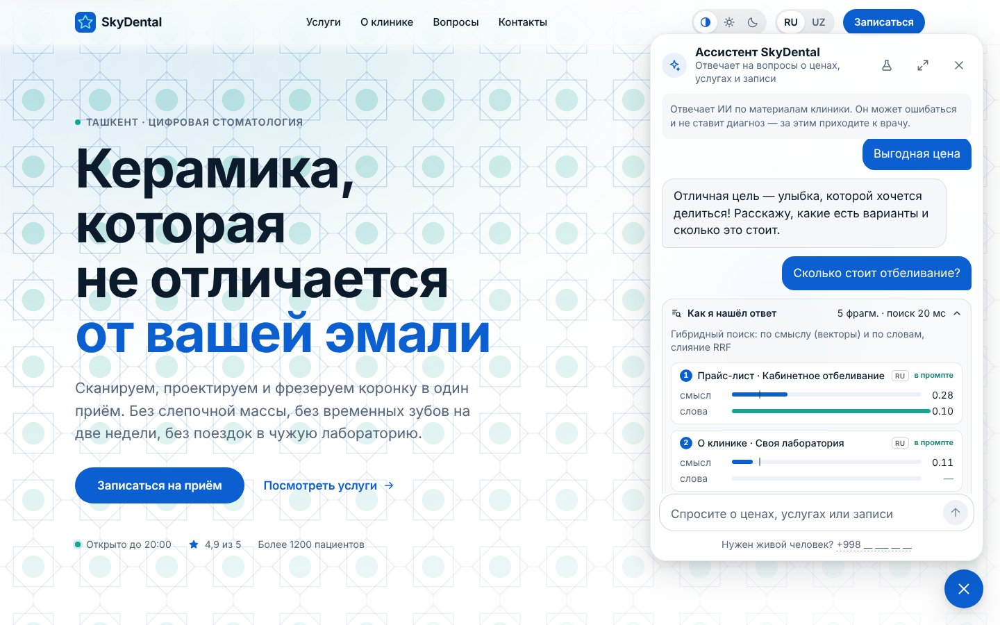
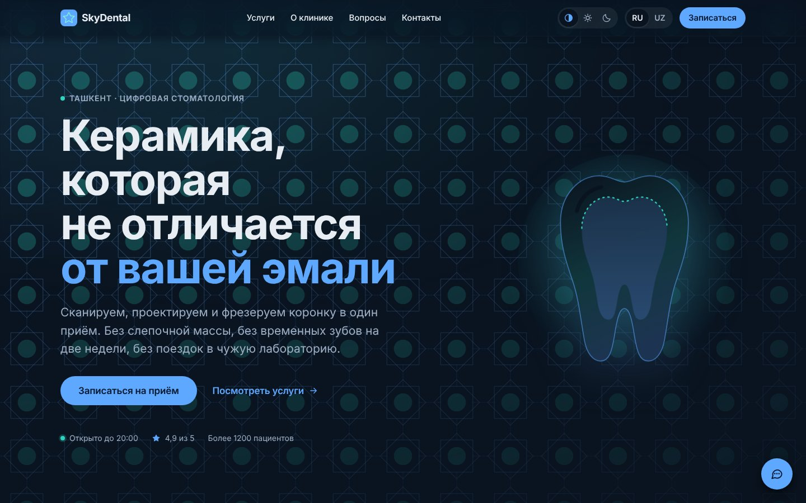
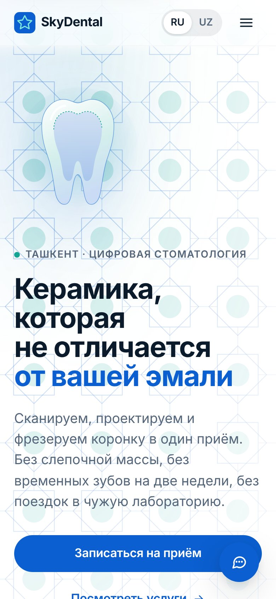
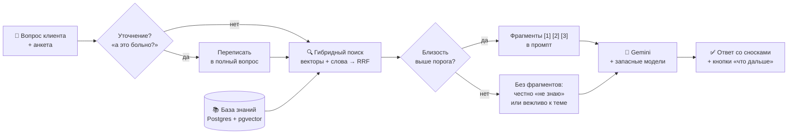

<div align="center">


# SkyDental — AI-ассистент стоматологической клиники

**Сайт клиники в Ташкенте с умным чат-консультантом на RAG.**
Отвечает только по базе знаний клиники, не выдумывает цены, говорит на русском и узбекском
и подстраивается под каждого собеседника.

[](https://react.dev)
[](https://www.typescriptlang.org)
[](https://vite.dev)
[](https://hono.dev)
[](https://ai.google.dev)
[](https://github.com/pgvector/pgvector)
[](https://vercel.com)

[Возможности](#-возможности) · [Как это работает](#-как-работает-rag) · [Быстрый старт](#-быстрый-старт) · [Стек](#-стек) · [Автор](#-автор)

<br />



</div>

---

## ✨ Возможности

<table>
<tr>
<td width="50%" valign="top">

### 🤖 Умный консультант
- Отвечает **только по базе знаний** клиники — со сносками на источник `[1]`
- **Не выдумывает** цены, скидки, адреса и сроки
- Вопросы не по теме («какой лучший парк?») — с юмором возвращает к улыбке и зубам
- Живой характер: консультант **Алия** говорит тепло, с игрой слов, не монотонно
- После каждого ответа — **кнопки «что спросить дальше»**
- Защита от prompt-инъекций

</td>
<td width="50%" valign="top">

### 🎯 Подход к каждому клиенту
- В начале чата — **3 вопроса-кнопки**:
  что привело · как удобнее общаться · что важнее всего
- По ответам бот меняет **тон, длину и акценты**:
  коротко или подробно, с юмором или по делу,
  про цену, безболезненность, качество или скорость
- Мягко ведёт к записи — **без давления**
  и без выдуманных акций

</td>
</tr>
<tr>
<td width="50%" valign="top">

### 🔍 Настоящий RAG
- **Гибридный поиск**: векторы (pgvector) + полнотекстовый, слияние через RRF
- Вопрос на узбекском находит русский фрагмент
- Уточнения («а это больно?») переписываются в полный вопрос
- Порог близости: слабые совпадения не попадают в промпт
- Панель **«Как я нашёл ответ»** — видно фрагменты, оценки и модель

</td>
<td width="50%" valign="top">

### ⚙️ Для владельца клиники
- **Админка**: диалоги, отзывы 👍/👎, пробелы в базе, статистика
- **Редактор базы знаний** с версиями и diff
- Синхронизация с **Google Drive** (Word и Excel → база)
- **Цепочка моделей** с автоматическим запасным вариантом
- Быстрые ответы: первое слово ≈ **1–1,5 с**
- Rate limit, IP хранится только в виде хеша

</td>
</tr>
</table>

### 🖼 Скриншоты

<table>
<tr>
<td width="50%"></td>
<td width="50%"></td>
</tr>
<tr>
<td align="center"><sub>Анкета: бот узнаёт, как общаться с клиентом</sub></td>
<td align="center"><sub>Ответ по базе знаний и панель «Как я нашёл ответ»</sub></td>
</tr>
<tr>
<td width="50%"></td>
<td width="50%" align="center"></td>
</tr>
<tr>
<td align="center"><sub>Тёмная тема</sub></td>
<td align="center"><sub>Мобильная версия</sub></td>
</tr>
</table>

---

## 🧠 Как работает RAG



1. **Вопрос** приходит вместе с ответами анкеты (только коды, свободный текст в промпт не попадает).
2. **Поиск** находит до 5 подходящих фрагментов в базе знаний клиники.
3. **Модель** отвечает строго по фрагментам и ставит сноски `[n]`. Если в базе ответа нет, честно говорит об этом.
4. **Клиент** видит ответ потоком, кнопки следующего шага и (по желанию) весь путь поиска.

---

## 🚀 Быстрый старт

> Нужен **Node.js 20+** и бесплатный ключ Gemini с [aistudio.google.com](https://aistudio.google.com/apikey).

```bash
git clone https://github.com/Sanjar318s/dental-clinic-ai-assistant.git
cd dental-clinic-ai-assistant
npm install
```

Скопируйте `.env.example` в `.env` и вставьте ключ:

```env
GEMINI_API_KEY=ваш_ключ
```

Загрузите базу знаний и запустите:

```bash
npm run seed     # индексирует content/rag/*.md в локальную базу
npm run dev      # сайт: http://localhost:5173  ·  API: http://localhost:8787
```

<details>
<summary><b>Без ключа (офлайн-режим для разработки)</b></summary>

В `.env` поставьте:

```env
LLM_CHAIN=local:extractive
EMBED_PROVIDER=local
EMBED_MODEL=hash-768
RAG_MIN_SCORE=0.15
```

Бот будет искать по совпадению слов и отвечать найденным фрагментом. Подходит, чтобы проверить интерфейс, но не для качества.
</details>

<details>
<summary><b>Все команды</b></summary>

| Команда | Что делает |
|---|---|
| `npm run dev` | Сайт и API вместе, с горячей перезагрузкой |
| `npm run build` | Проверка типов и сборка в `dist/` |
| `npm run typecheck` | Только проверка типов |
| `npm run seed` | Загрузить базу знаний (`--force`, `--reindex`) |
| `npm run eval` | Оценка качества поиска: hit@k, MRR, подбор порога |
| `npm run db:migrate` | Применить схему базы (нужно для Neon/Vercel) |
| `npm run export:office` | Выгрузить базу в Word и Excel |

</details>

<details>
<summary><b>Админка</b></summary>

Откройте `http://localhost:5173/admin.html`. Пароль задаётся в `.env`:

```env
ADMIN_PASSWORD=придумайте_пароль
ADMIN_SECRET=длинная_случайная_строка
```

</details>

---

## 🛠 Стек

| Слой | Технологии |
|---|---|
| **Фронтенд** | React 19, TypeScript, Vite 7, собственная дизайн-система (светлая и тёмная темы, RU/UZ) |
| **Бэкенд** | Hono на Node.js, потоковые ответы (SSE), Zod-валидация |
| **База** | PostgreSQL + pgvector: Neon в продакшене, встроенный PGlite локально |
| **AI** | Gemini (Flash-Lite) + цепочка запасных моделей; также OpenAI, OpenRouter, Groq, DeepSeek, Anthropic, Ollama |
| **Эмбеддинги** | `gemini-embedding-001` (768 измерений) |
| **Деплой** | Vercel (одна serverless-функция `/api/*`) |

<details>
<summary><b>Структура проекта</b></summary>

```
├── src/                  # фронтенд: лендинг, чат, админка
│   ├── components/chat/  # чат-виджет, анкета, панель RAG
│   ├── admin/            # админ-панель
│   └── i18n/             # тексты RU / UZ
├── server/
│   ├── rag/              # поиск, промпты, ответ, синхронизация
│   ├── llm/              # провайдеры и цепочка fallback
│   ├── admin/            # API админки
│   └── db/               # схема и клиент Postgres
├── shared/               # общий протокол фронта и сервера
├── content/rag/          # база знаний клиники (.md)
├── eval/golden.json      # 35 эталонных вопросов для оценки
└── scripts/              # seed, eval, migrate, export
```

</details>

---

## 📚 Документация

- [Подробная документация на русском](README.ru.md)
- [Batafsil hujjatlar (oʻzbekcha)](README.uz.md)
- [Full documentation in English](README.en.md)

> ℹ️ Данные клиники (телефон, адрес, лицензия) в проекте — заглушки `__`. Перед реальным запуском заполните их в `src/i18n/ru.ts` и `src/i18n/uz.ts`.

---

## 👨‍💻 Автор

<table>
<tr>
<td>

**Санжар** — Full Stack разработчик

Создаю проекты любой сложности, от простых до серьёзных:
сайты · Telegram-боты · мобильные приложения (APK) · игры

📞 **+998 50 111 45 85**
✈️ Telegram: **[@kiti1803](https://t.me/kiti1803)**
🐙 GitHub: **[@Sanjar318s](https://github.com/Sanjar318s)**

</td>
</tr>
</table>

<div align="center">

<sub>Если проект понравился — поставьте ⭐</sub>

</div>
